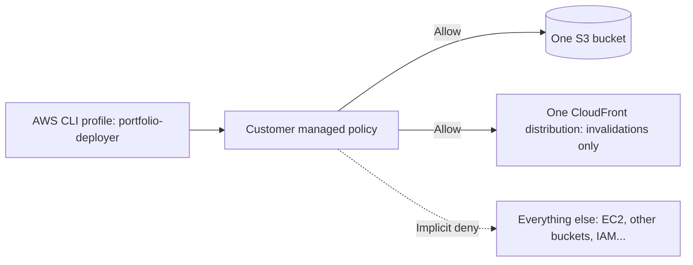
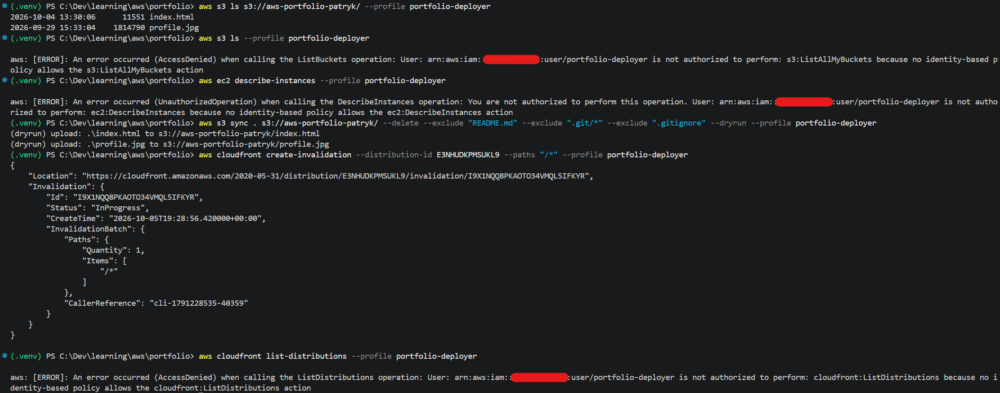

# AWS IAM Least Privilege: a deploy-only user

A small, hands-on project that applies the **principle of least privilege**: instead of deploying my website with an administrator account, I created a dedicated IAM user that can do exactly two things and nothing else.

> Project 2 of my 10-project AWS learning path. It builds on [Project 1: portfolio on S3 + CloudFront](https://github.com/patrykburger/portfolio).

## The problem

Deploying a static site only needs to upload files to one S3 bucket and clear the cache of one CloudFront distribution. Using an admin user for that means a leaked key or a script mistake could affect the whole AWS account.

## The solution



- **IAM user** `portfolio-deployer`: no console access, programmatic access only
- **Customer managed policy** `PortfolioDeployLeastPrivilege` (see [`policy.json`](policy.json)):
  - `s3:ListBucket` on the bucket
  - `s3:GetObject`, `s3:PutObject`, `s3:DeleteObject` on the objects inside it
  - `cloudfront:CreateInvalidation` and `GetInvalidation` on one distribution
- Everything not explicitly allowed is denied (IAM's default)

Replace `ACCOUNT_ID` in the policy with your own AWS account ID.

## How I built it

1. Created the policy in the IAM console (JSON editor)
2. Created the user without console access and attached the policy directly
3. Generated an access key for CLI use and stored it in a separate named profile:
   ```bash
   aws configure --profile portfolio-deployer
   ```
4. Verified the identity:
   ```bash
   aws sts get-caller-identity --profile portfolio-deployer
   ```

## Proof that it works

| # | Command (with `--profile portfolio-deployer`) | Expected result |
|---|-----------------------------------------------|-----------------|
| 1 | `aws s3 ls s3://aws-portfolio-patryk/` | Works: lists the site files |
| 2 | `aws s3 ls` | AccessDenied: cannot list other buckets |
| 3 | `aws ec2 describe-instances` | UnauthorizedOperation: no EC2 access |
| 4 | `aws cloudfront create-invalidation --distribution-id <ID> --paths "/*"` | Works: status `InProgress` |
| 5 | `aws cloudfront list-distributions` | AccessDenied: cannot manage distributions |

The denied calls are the point: they show the permissions are scoped to the single job.



## Security notes

- Access keys are never committed (see [`.gitignore`](.gitignore)). They live in `~/.aws/credentials`, outside the repository.
- If a key is ever exposed: set it to **Inactive** in IAM, then delete it.
- Access keys are long-lived credentials. Roles with temporary credentials (or IAM Identity Center) are the better choice for real workloads, which I'll cover in a later project.

## What I learned (Cloud Practitioner topics)

- Principle of least privilege and IAM's default deny
- IAM users, policies (AWS managed vs customer managed) and ARNs
- Difference between `ListBucket` (bucket) and object-level actions
- Shared responsibility model: access configuration is my responsibility
- Named profiles in the AWS CLI

## Next steps

- Replace the long-lived key with an IAM role and temporary credentials
- Add a permissions boundary
- Review activity with CloudTrail and IAM Access Analyzer